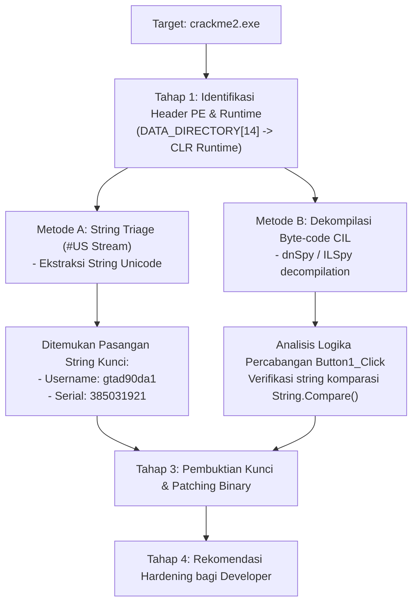

# 🔍 Writeup Edukasi Reverse Engineering: CrackMe 1.0
### *Lab Studi Kasus dari Toolkit Syai Labs*

> **Dedikasi & Penghargaan Khusus (Credits):**  
> Ditulis sebagai panduan edukasi reverse engineering berdasarkan berkas latihan *CrackMe 1.0* dari **Syai Labs**, materi kurikulum yang dibawakan oleh **Yohanes Syailendra Kotualubun, M.Kom (Pak Syai)**.

---

## 🎯 Ringkasan Target

* **Nama Berkas:** `crackme2.exe` (disertai `CrackMe.pdb` dan `CrackMe.xml`)
* **Ukuran:** 244.736 byte
* **Arsitektur:** PE32 (.NET CLR Managed Assembly)
* **Tujuan Tantangan:** Menemukan pasangan **Username** dan **Serial Number** yang valid agar memunculkan pesan `"Crack Successful! Great Job!"`.

---

## 🛠️ Metodologi Analisis



---

## 🔬 Langkah Investigasi Langkah-demi-Langkah

### Tahap 1: Identifikasi Biner & Arsitektur
Sebelum melakukan *debugging*, dilakukan triage statis awal pada berkas:
1. Memeriksa entri *Data Directory*:
   * Indeks ke-14 pada Optional Header PE menunjuk ke `IMAGE_DIRECTORY_ENTRY_COM_DESCRIPTOR` (CLR Header).
   * Alamat Virtual: `0x2000`, yang mengonfirmasi bahwa aplikasi ini dibangun menggunakan framework **Microsoft .NET Framework (CLR)**.
2. Keberadaan berkas pendukung `CrackMe.xml` dan `CrackMe.pdb` mengonfirmasi bahwa target dikompilasi dengan profil rilis Visual Studio (Visual Basic .NET / C#).

### Tahap 2: Ekstraksi User Strings Stream (`#US`)
Pada metadata aplikasi .NET, string literal yang digunakan dalam kode program disimpan pada metadata stream bernama `#US` (*User Strings*) dalam format UTF-16LE.

Dengan menjalankan ekstraksi string pada biner:
```python
import re
with open("crackme2.exe", "rb") as f:
    data = f.read()
# Mencari sekuens karakter UTF-16
strings = re.findall(b'(?:[\x20-\x7e]\x00){3,}', data)
for s in strings:
    print(s.decode('utf-16le', errors='ignore'))
```

**Hasil Temuan Kunci String:**
```text
US: 'Form1'
US: 'Crack Me!'
US: 'TextBox1'
US: 'Username'
US: 'TextBox2'
US: 'Serial Number'
US: 'gtad90da1'
US: '385031921'
US: 'Crack Successful! Great Job!'
US: 'Cracked'
US: 'Wrong... Serial Try Again!'
US: 'Error'
```

### Tahap 3: Analisis Logika Validasi (`Button1_Click`)
Jika berkas dibuka melalui dekompiler .NET seperti **dnSpy** atau **ILSpy**, logika pada event handler tombol validasi (`Button1_Click`) terlihat jelas:

```csharp
private void Button1_Click(object sender, EventArgs e)
{
    if (string.Compare(this.TextBox1.Text, "gtad90da1") == 0 && 
        string.Compare(this.TextBox2.Text, "385031921") == 0)
    {
        MessageBox.Show("Crack Successful! Great Job!", "Cracked", MessageBoxButtons.OK, MessageBoxIcon.Asterisk);
    }
    else
    {
        MessageBox.Show("Wrong... Serial Try Again!", "Error", MessageBoxButtons.OK, MessageBoxIcon.Hand);
    }
}
```

---

## 🚩 Flag & Kunci Solusi

| Bidang Input | Kunci yang Diperlukan | Keterangan |
| :--- | :--- | :--- |
| **Username** | `gtad90da1` | *Hardcoded string* sensitif huruf besar/kecil |
| **Serial Number** | `385031921` | *Hardcoded serial string* |

---

## 🔧 Alternatif: Binary Patching (Bypass Serial)

Selain memasukkan kunci yang benar, seorang reverse engineer dapat mem-patch instruksi percabangan CIL (*Common Intermediate Language*):

1. **CIL Asli:**
   ```cil
   call bool [mscorlib]System.String::op_Equality(string, string)
   brfalse.s IL_0035  // Lompat ke blok error jika salah
   ```
2. **Patch:**
   * Ubah opcode `brfalse.s` (`0x2C`) menjadi instruksi `nop` (`0x00`) atau `brtrue.s` (`0x2D`).
   * Hasilnya, input apa pun (atau tanpa input sekalipun) akan langsung memicu blok `"Crack Successful!"`.

---

## 🛡️ Pelajaran Keamanan untuk Software Developer (Defensive Lessons)

Dari lab ini, developer perangkat lunak dapat menarik beberapa mitigasi krusial:
1. **Jangan Menyimpan Rahasia Plaintext dalam Kode Sumber:**
   * Biner .NET dan Java sangat mudah didekompilasi kembali ke kode sumber aslinya jika tidak diproteksi.
2. **Terapkan Obfuscation:**
   * Gunakan tool *code protection* seperti ConfuserEx, Dotfuscator, atau VMProtect untuk mengacak nama simbol, mengenkripsi string literal, dan merusak alur kontrol (*control-flow flattening*).
3. **Validasi Berbasis Kriptografi Asimetris:**
   * Sistem lisensi modern memverifikasi signature digital menggunakan *Public Key Cryptography* (RSA / ECDSA) di mana *private key* hanya disimpan di server lisensi, sehingga serial key tidak dapat ditebak secara statis dari biner klien.
