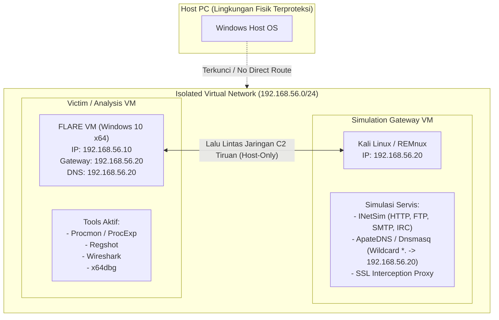
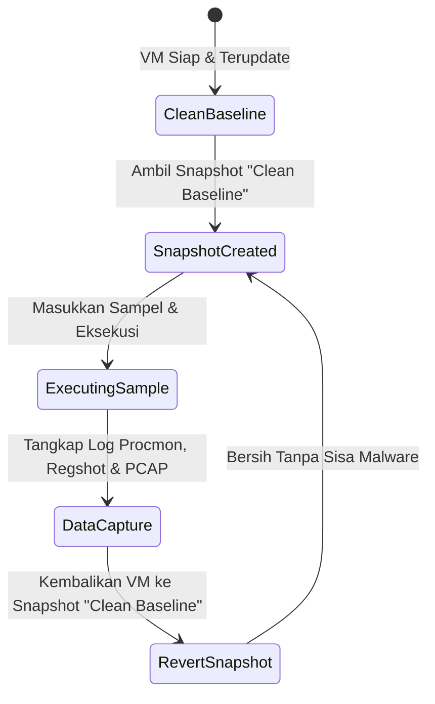

# 🏗️ Blueprint Arsitektur Lab Malware Terisolasi
### *Isolated Sandbox Environment & Air-Gapped Analysis Blueprint*

> **Dedikasi & Penghargaan Khusus (Credits):**  
> Didesain berdasarkan standar operasional dan arsitektur lab analitis **Syai Labs** yang dibawakan oleh **Yohanes Syailendra Kotualubun, M.Kom (Pak Syai)**.

---

## 🛡️ Prinsip Keamanan Isolasi Mutlak (Golden Rules)

Sebelum menyentuh sampel malware apa pun di lingkungan dinamis, aturan berikut wajib diterapkan:

1. **Host-Guest Isolation:** Matikan semua fitur interaksi VirtualBox/VMware:
   * ❌ *Disable Shared Folders* (Cegah malware mengenkripsi drive host via ransomware).
   * ❌ *Disable Shared Clipboard* (Cegah infeksi melalui clipboard hijacking).
   * ❌ *Disable Drag and Drop* (Cegah transfer berkas tidak sengaja).
2. **Air-Gapped Network Isolation:**
   * Jangan pernah menghubungkan mesin VM analisis malware ke mode *Bridged* atau *NAT* langsung ke internet publik.
   * Gunakan adapter mode **Host-Only Network** atau **Internal Network**.

---

## 📐 Diagram Topologi Jaringan Lab



---

## 📋 Langkah-demi-Langkah Konfigurasi

### 1. Konfigurasi Gateway Simulasi (Kali / REMnux)
Gateway bertindak sebagai peniru seluruh internet (Internet Simulator):
* Pasang paket **INetSim**:
  ```bash
  sudo apt-get update && sudo apt-get install inetsim
  ```
* Buka `/etc/inetsim/inetsim.conf` dan atur:
  ```ini
  service_bind_address   192.168.56.20
  dns_default_ip         192.168.56.20
  ```
* Jalankan INetSim:
  ```bash
  sudo inetsim
  ```
* Setiap request HTTP/HTTPS/DNS dari malware di Windows VM akan dijawab otomatis dengan balasan valid tiruan, sehingga malware terus mengeksekusi payload tanpa merusak internet nyata.

---

### 2. Konfigurasi Korban Analisis (FLARE VM Windows 10)
* Unduh dan pasang FLARE VM melalui script resmi Mandiant PowerShell:
  ```powershell
  (New-Object System.Net.WebClient).DownloadFile("https://raw.githubusercontent.com/mandiant/flare-vm/master/install.ps1", "C:\install.ps1")
  # Eksekusi instalasi
  ```
* Atur IP statis adapter Host-Only:
  * **IP Address:** `192.168.56.10`
  * **Subnet Mask:** `255.255.255.0`
  * **Default Gateway:** `192.168.56.20` (IP Gateway Kali/REMnux)
  * **Preferred DNS:** `192.168.56.20`

---

### 3. Kebijakan Manajemen Snapshot (Snapshot Lifecycle)



1. **Snapshot "Clean Baseline":**
   * Diambil saat sistem operasi benar-benar bersih, Windows Update dimatikan, dan tool analisis telah siap di desktop.
2. **Eksekusi Malware:**
   * Sampel dijalankan, data telemetri (Procmon PML, PCAP, Regshot diff) dicatat.
3. **Rollback Mutlak:**
   * Setelah selesai, **jangan matikan VM secara normal**. Lakukan *Revert to Current Snapshot*. Dalam hitungan detik, seluruh memori dan disk kembali steril ke keadaan awal sebelum malware menyentuh disk.

---

### 4. Alternatif Ringan: Antigravity Automated Sandbox CLI
Jika tidak ingin menjalankan VM berat (VirtualBox), Anda dapat menggunakan modul terisolasi bawaan dari repositori ini:
```bash
# Menjalankan static triage + dynamic sandbox + registry diffing + local sinkhole
python sandbox_cli.py sample.exe --dynamic --timeout 10 --reg-diff --sinkhole
```
Sistem akan menjalankan isolasi proses lokal, menangkap modifikasi registry, dan melayani C2 request secara lokal.
