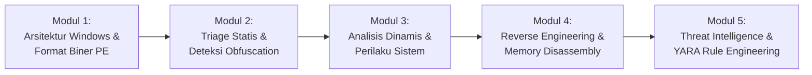

# 🎓 Kurikulum Terbuka Analisis Malware & Forensik Biner Indonesia
### *Awesome Malware Analysis & Reverse Engineering Curriculum*

> **Dedikasi & Penghargaan Khusus (Credits & Acknowledgement):**  
> Kurikulum ini didedikasikan dan terinspirasi langsung dari materi workshop **Syai Labs** yang dibawakan oleh **Yohanes Syailendra Kotualubun, M.Kom, CEH, ECSA, CCNA (Pak Syai)** — Senior Cybersecurity Consultant, Peneliti *Indonesia Honeynet Project (IHP)* divisi Malware Stream, dan Juara Kompetisi Cyber Defence Kementerian Pertahanan RI (Kemhan) 2013-2015.

---

## 📌 Pendahuluan

Tujuan dari kurikulum terbuka ini adalah memberikan panduan pembelajaran terstruktur, aplikatif, dan berstandar industri bagi mahasiswa, praktisi, dan antusias keamanan siber di Indonesia untuk memahami cara kerja malware, teknik triage statis/dinamis, hingga reverse engineering tingkat lanjut.

---

## 🗺️ Peta Jalur Pembelajaran (Learning Roadmap)

---

## 📚 Silabus Modul

### Modul 1: Fondasi Arsitektur Sistem & Struktur PE (Portable Executable)
1. **Model Memori Windows:**
   * Ruang Alamat Virtual (*Virtual Address Space* x86 vs x64).
   * User Mode vs Kernel Mode privilege rings.
2. **Bedah Struktur Berkas PE (Portable Executable):**
   * *DOS Header (`IMAGE_DOS_HEADER`)* & Magic bytes `MZ` (`0x5A4D`).
   * *PE Header (`IMAGE_NT_HEADERS`)*: Signature `PE\0\0`, `FileHeader`, dan `OptionalHeader`.
   * *Section Table*: `.text` (kode eksekusi), `.data` (variabel global), `.rdata` (konstanta/impor), `.rsrc` (resources).
   * *Import Address Table (IAT)* & *Export Address Table (EAT)*.
3. **Praktek Mandiri:**
   * Menggunakan Python `pefile` untuk mem-parsing IAT dan mendeteksi API berbahaya (`VirtualAllocEx`, `WriteProcessMemory`, `CreateRemoteThread`).

---

### Modul 2: Triage Statis & Deteksi Packing (Anti-Analysis)
1. **Kriptografi & Integritas Hash:**
   * MD5, SHA-1, SHA-256, dan SSDEEP (fuzzy hashing).
   * *Imphash* (Import Hash) untuk mengelompokkan keluarga malware (*malware families*).
2. **Shannon Entropy Analysis:**
   * Matematika entropi informasi (0.0 s/d 8.0).
   * Mengapa entropi $> 7.0$ menjadi indikator kuat berkas dienkripsi atau dipadatkan (*packed*).
3. **Identifikasi Packer & Compiler:**
   * Mengenal signature packer populer: UPX, Themida, ASPack, MPRESS, VMProtect.
   * Tool praktikum: Detect It Easy (DIE), PEiD, dan modul bawaan `PackerDetector`.
4. **Ekstraksi String & Indikator Kompromi (IoC):**
   * Format string ASCII vs Unicode (UTF-16LE).
   * Regex filtering untuk mengekstrak C2 URL, IP Address, Registri Keys, dan Mutex strings.

---

### Modul 3: Analisis Dinamis Terisolasi & Rekayasa Jaringan
1. **Manajemen Lab Analisis Terisolasi:**
   * Konfigurasi VirtualBox / VMware dengan jaringan *Host-Only* (Air-gapped).
   * Menggunakan VM terspesialisasi: **FLARE VM** (Mandiant) & **Kali Linux**.
   * Praktik snapshot baseline higienis.
2. **Pemantauan Perilaku Host (Host Behavioral Monitoring):**
   * *Sysinternals Suite*: Process Monitor (Procmon), Process Explorer.
   * *Registry Diffing*: Teknik Regshot untuk menangkap persistensi autorun (`CurrentVersion\Run`, `RunOnce`, Services).
   * *File Integrity*: FolderChangesView untuk mendeteksi berkas dropper/ekstraksi di `%TEMP%` atau `%APPDATA%`.
3. **Simulasi Jaringan C2 (Network Sinkholing):**
   * Membelokkan DNS query malware ke server loopback lokal menggunakan ApateDNS atau Python Sinkhole.
   * Menirukan respon server web C2 menggunakan INetSim atau FakeNet-NG.

---

### Modul 4: Reverse Engineering & Disassembly Tingkat Lanjut
1. **Pengantar Assembly x86/x64:**
   * Register CPU: EAX/RAX (return), ECX/RCX (counter), ESP/RSP (stack pointer), EBP/RBP (base pointer), EIP/RIP (instruction pointer).
   * Instruksi umum: `MOV`, `PUSH`, `POP`, `CALL`, `RET`, `CMP`, `JMP`, `JZ`/`JE`, `JNZ`/`JNE`.
2. **Penggunaan Debugger & Disassembler:**
   * Disassembler statis: IDA Pro, Ghidra, Cutter/Rizin.
   * Debugger dinamis: x64dbg / x32dbg, OllyDbg, Immunity Debugger.
3. **Teknik Unpacking Manual:**
   * Mencari *Original Entry Point* (OEP).
   * Mengenali instruksi ekor unpacking (misal: *tail jump* `JMP` panjang pada UPX).
   * Melakukan dumping memori proses via Scylla atau OllyDumpEx dan memperbaiki IAT.
4. **Analisis Malware Managed (.NET):**
   * Menggunakan dekompiler dnSpy atau ILSpy untuk membongkar byte-code CIL/MSIL langsung ke kode sumber C#/VB.

---

### Modul 5: Threat Intelligence, YARA Rules & Mitigasi Blue Team
1. **Pemetaan MITRE ATT&CK Framework:**
   * Mengidentifikasi taktik: *Initial Access*, *Execution*, *Persistence*, *Privilege Escalation*, *Defense Evasion*, *C2*.
2. **Rekayasa Aturan YARA (YARA Rule Engineering):**
   * Anatomi aturan YARA: `meta`, `strings` (hex, text, regex), `condition`.
   * Strategi menulis signature yang tahan terhadap mutasi biner (*resilient signatures*).
3. **Penyusunan Laporan Triage Insiden:**
   * Standar format laporan forensik eksekutif dan teknis (JSON & HTML).

---

## 🛠️ Rekomendasi Toolkit Praktikum

| Kategori | Tool Rekomendasi |
| :--- | :--- |
| **Sandbox Otomatis** | [Antigravity Malware Sandbox](https://github.com/Arya-Penangsang/antigravity-malware-sandbox) |
| **Sistem Operasi Lab** | FLARE VM (Windows), REMnux (Linux), Kali Linux |
| **PE Triage** | Detect It Easy (DIE), pestudio, CFF Explorer, PeNet |
| **Hex Editor** | HxD, 010 Editor |
| **Monitoring** | Sysinternals Procmon, Process Hacker, Regshot |
| **Network Simulator** | INetSim, FakeNet-NG, Wireshark, NetworkSinkhole (Python) |
| **Disassembler** | Ghidra (NSA Open Source), IDA Free, x64dbg, dnSpy (.NET) |

---
*Dibuat untuk komunitas keamanan siber dan akademisi Indonesia.*
