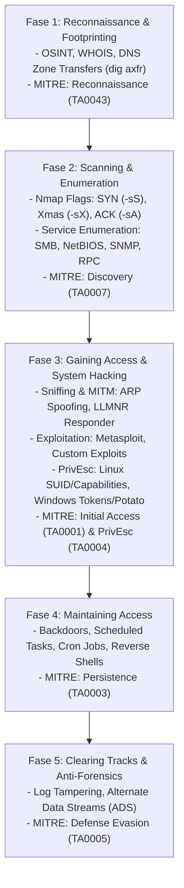

# ⚔️ Infrastructure Red Teaming & CEH Framework

Framework operasional pengujian penetrasi infrastruktur, jaringan, dan sistem operasi berbasis metodologi **CEH (Certified Ethical Hacker)**, **NIST SP 800-115**, dan **MITRE ATT&CK for Enterprise**.

---

## 🚀 Skrip Otomasi Bawaan (CLI Helper)
Skill ini menyertakan perkakas Python otomatis untuk enumerasi jaringan dan audit privesc lokal:
```bash
# 1. Audit port & banner grabbing multi-threaded:
python <skill-path>/scripts/infra_audit.py --scan 192.168.1.1 --ports 21,22,80,443,445,3389

# 2. Audit vektor Local Privilege Escalation (LPE) pada host saat ini:
python <skill-path>/scripts/infra_audit.py --audit-privesc

# 3. Uji SMB Null Session & Anonymous Share:
python <skill-path>/scripts/infra_audit.py --smb-check 192.168.1.10
```

---

## 🏛️ Siklus 5 Fase CEH & Pemetaan MITRE ATT&CK



---

## 🔬 Prosedur Operasional Setiap Fase

### 1. Fase 1: Reconnaissance & Footprinting
* **DNS Reconnaissance & Zone Transfer:**
  ```bash
  # Uji DNS AXFR (Zone Transfer misconfiguration)
  dig axfr @ns1.target.com target.com
  
  # Reverse DNS Lookup range IP
  dnsrecon -r 192.168.1.0/24 -d target.com
  ```
* **Subdomain & Service Mapping:**
  * Gunakan Subfinder, Amass, atau crt.sh certificate transparency logs.

---

### 2. Fase 2: Scanning & Service Enumeration
* **Firewall Evasion Nmap Scan Types:**
  * **SYN Stealth Scan (`-sS`):** Standar industri; tidak menyelesaikan handshake TCP 3 arah (reset dengan RST).
  * **TCP ACK Scan (`-sA`):** Memetakan aturan firewall (*Stateful* vs *Stateless*). Port `filtered` menandakan firewall aktif.
  * **Inverse TCP Scanning (`-sN` Null, `-sF` FIN, `-sX` Xmas):** Memanfaatkan RFC 793; paket tanpa flag SYN/RST/ACK yang dikirim ke port tertutup akan dibalas RST, sedangkan port terbuka akan mendiamkan paket (*no response*). Efektif pada sistem Unix/Linux non-RFC compliant Windows.
  * **UDP Scanning (`-sU`):** Menemukan servis penting: DNS (53), SNMP (161), DHCP (67/68), NTP (123).
* **Deep Service Enumeration:**
  * **SMB / NetBIOS (Port 139/445):**
    ```bash
    # Uji Null Session (IPC$ share tanpa password)
    smbclient -N -L //target-ip
    enum4linux -a target-ip
    ```
  * **SNMP Enumeration (UDP 161):**
    ```bash
    # Ekstraksi MIB strings via community public/private
    snmpwalk -v2c -c public target-ip 1.3.6.1.2.1.25.4.2.1.2
    ```

---

### 3. Fase 3: Sniffing, MITM & System Hacking

#### A. Network Sniffing & MITM
* **ARP Poisoning / Spoofing:**
  * Mengirim paket ARP balasan palsu (*gratuitous ARP*) ke gateway dan korban untuk merutekan seluruh traffic melalui mesin penyerang.
* **LLMNR / NBT-NS Poisoning (Responder):**
  * Saat klien Windows salah mengetikkan alamat server (misal: `\\server_keuangan`), mesin klien akan mengirim broadcast query LLMNR/NetBIOS.
  * Tool seperti *Responder* merespons broadcast tersebut secara agresif, memaksa korban mengirimkan hash **NetNTLMv2** untuk di-crack secara offline.

#### B. Local Privilege Escalation (LPE)

##### 🐧 Linux Privilege Escalation Checklist:
1. **SUID / SGID Binaries:**
   ```bash
   find / -perm -4000 -type f 2>/dev/null
   # Cocokkan biner berbahaya dengan referensi GTFOBins (misal: nmap, vim, find, bash)
   ```
2. **Sudo Privileges Misconfiguration:**
   ```bash
   sudo -l
   # Periksa apakah ada biner yang diizinkan dijalankan tanpa password (NOPASSWD)
   ```
3. **Linux Capabilities:**
   ```bash
   getcap -r / 2>/dev/null
   # Contoh berisiko: /usr/bin/python3 = cap_setuid+ep
   ```
4. **Crontab & Writable Scripts:**
   * Periksa skrip yang dijalankan oleh root secara berkala (`/etc/crontab`, `/var/spool/cron/`) dan pastikan hak tulisnya terbatas.

##### 🪟 Windows Privilege Escalation Checklist:
1. **Token Impersonation & Potato Family:**
   * Jika service account memiliki hak **`SeImpersonatePrivilege`** atau **`SeAssignPrimaryTokenPrivilege`** (misal: IIS APPPOOL atau LOCAL SERVICE), gunakan teknik *Potato* (*SweetPotato, JuicyPotato, GodPotato*) untuk eskalasi instan ke **`NT AUTHORITY\SYSTEM`**.
2. **Unquoted Service Paths:**
   * Service dengan jalur tanpa tanda kutip dan mengandung spasi (misal: `C:\Program Files\My App\service.exe`).
   * Penyerang dapat menaruh payload `C:\Program.exe` atau `C:\Program Files\My.exe`.
3. **AlwaysInstallElevated:**
   * Jika kunci registri `HKCU\Software\Policies\Microsoft\Windows\Installer\AlwaysInstallElevated` bernilai `1`, installer MSI apa pun akan dieksekusi dengan hak istimewa SYSTEM.

---

### 4. Fase 4: Maintaining Access & Lateral Movement
* **Pivoting & Port Forwarding:**
  * Menggunakan Chisel, Ligolo-ng, atau SSH Dynamic Port Forwarding (`ssh -D 1080`) untuk melompat dari server DMZ ke segmen jaringan privat internal.
* **Pass-the-Hash (PtH) & Overpass-the-Hash:**
  * Menggunakan hash NTLM tanpa perlu melakukan cracking untuk mengautentikasi ke mesin Windows lain via SMB / WinRM (*Impacket psexec.py / wmiexec.py*).

---

### 5. Fase 5: Clearing Tracks & Anti-Forensics
* **Audit Kerentanan Jejak Log:**
  * Mengevaluasi apakah sistem mencatat Event ID 4688 (Proses dibuat dengan Command Line Logging) atau Sysmon Event ID 1.
  * Memeriksa keberadaan Alternate Data Streams (ADS) pada sistem berkas NTFS (`dir /R`).

---

## 📊 Matriks Pelaporan Temuan Infrastruktur

| ID Kerentanan | Vektor & Komponen | Kategori CEH | Severity (CVSS v3.1) | Tindakan Mitigasi Defensif |
| :--- | :--- | :--- | :--- | :--- |
| **INF-01** | Port 445 SMB Null Session | Enumeration | **HIGH (7.5)** | Matikan `RestrictNullSessAccess` & batasi SMB anonymous access via GPO. |
| **INF-02** | LLMNR / NBT-NS Enabled | Sniffing / MITM | **HIGH (7.4)** | Nonaktifkan LLMNR via Group Policy (`Turn off multicast name resolution`). |
| **INF-03** | Service Account `SeImpersonate` | System Hacking | **CRITICAL (8.8)** | Hapus hak istimewa impersonasi dari service account non-administrator. |
| **INF-04** | Biner SUID `/usr/bin/find` | PrivEsc (Linux) | **CRITICAL (9.0)** | Hapus bit SUID: `chmod u-s /usr/bin/find`. |
